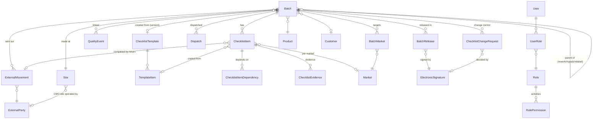

# 2. Data model

The **Batch** is the centre: every other business record carries a `BatchId`.

## Entities
| Entity | Purpose | Key fields |
|---|---|---|
| **Batch** | One manufactured batch (or child batch) | BatchNo (unique), Product, Site, Customer, BatchType, ParentBatch, LotType, BatchSize+unit, ManufacturingBlock, ProcessOrderDate, ManufacturingDate, BatchCompletionDate, TargetReleaseDate, ShelfLifeMonths, ExpiryDate (+override reason), Disposition (+reason), Template + version, CreatedAt/By, ReleasedAt; stored derived fields ReadinessPct, IsReadyForRelease, CurrentStage, LastProgressAt, DispatchByDate, Deadline, DeadlineType |
| **BatchMarket** | A target market of the batch | Market, RegulatoryStatus, ApprovalReference, ApprovedAt, Source, LastSyncedAt |
| **ChecklistItem** | A check for this batch (copied from template, editable via change control) | Code, Name, Stage, Department, ItemType, IsMandatory, Weight, Sequence (step), IsFinalRelease, Market, ExternalMovement, Status, DueDate, StartedAt, CompletedAt, CompletedBy, Comments, N/A justification, Blocked reason, EvidenceReference, Source, SourceReference, LastSyncedAt, IsRemoved |
| **ChecklistItemDependency** | "Cannot start until X is complete" | ItemId, DependsOnItemId |
| **ChecklistEvidence** | Attached file with SHA-256 | FileName, ContentType, Size, Sha256, Content, UploadedAt/By |
| **QualityEvent** | Deviation, OOS, OOT, CAPA, Change Control | Type, Number, Description, Status, Criticality, OpenedOn, ClosedOn, Source, LastSyncedAt |
| **ExternalMovement** | Material at a CMO, contract lab, packaging or labelling vendor | ExternalParty, Purpose, Status (Planned / SentOut / AtVendor / Returned / Closed), Quantity, Reference, SentOn, ReceivedByVendorOn, ExpectedReturnOn, ReturnedOn |
| **BatchRelease** | One signed release decision | Kind (Full / Partial / Conditional / FurtherProcessing), Quantity, Market, Justification, PendingItemsSummary, ReleasedAt/By, Signature |
| **Dispatch** | Stock leaving the warehouse | Quantity, Market, DispatchedOn, Reference |
| **ChecklistChangeRequest** | Add / remove / edit an item after creation | ChangeType, Item, proposed values, Reason, Status, RequestedBy/At, DecidedBy/At, Comment, Signature |
| **ChecklistTemplate / TemplateItem** | Reusable checklists with match criteria and version | Product, DosageForm, Market, Customer, BatchType, SiteType, Priority, Version; item Code, Stage, Department, ItemType, Mandatory, Weight (null = derived), Sequence, DueOffsetDays, IsFinalRelease, IsPerMarket, DefaultSource, DependsOn |
| **Product, Site, Market, Customer, Department, ExternalParty** | Master data (deactivate, never delete) | Market.MinShelfLifePctAtDispatch; ExternalParty.IsApproved, QualityAgreementValidUntil; Site.SiteType (Own / ContractManufacturer) |
| **User, Role, RolePermission, UserRole** | Admin-defined roles; permissions are a fixed catalogue of activities | User lockout fields, PasswordChangedAt |
| **ElectronicSignature** | Part 11 signature, append-only | User, FullName, Meaning, SignedAt, Entity, BatchId, RecordHash |
| **AuditEntry** | Append-only audit trail | Timestamp, User, Action, Entity, EntityId, BatchId, Field, OldValue, NewValue, Reason |
| **PrioritySettings** | Admin-configurable ranking parameters | Band size, penalties, stage weights, stuck days, warnings, segregation of duties |

## Design choices
- **Dates**: calendar dates are `DateOnly` (no time zone ambiguity); events are `DateTimeOffset` stored in UTC.
  Approval dates live in date fields, never in text.
- **Enums stored as text** so inspectors can read the database directly.
- **Checklist copied onto the batch** when it is created, with the template version; template edits never change a batch in progress.
- **Derived fields stored on the batch** (readiness, deadline, current stage) and recalculated on every change,
  so lists can be filtered and sorted in SQL; time-dependent flags (overdue, stuck) are evaluated at query time.
- **Partial release** is quantity-based on the parent batch (decision 10). Sub-lots with their own number can be
  modelled as child batches if a customer needs them.
